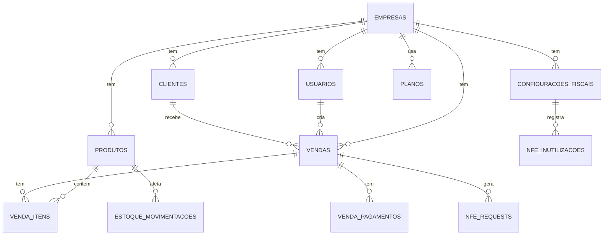

# DATA-MODEL.md — GestãoFácil Database Schema

Modelo de dados completo baseado em PLAN-API.md. Cada tabela tem `empresa_id` para isolamento multitenancy.

---

## Diagrama ER (Mermaid)



---

## Módulo 1: Autenticação e Multitenancy

### Tabela: `empresas`
```sql
CREATE TABLE empresas (
    id BIGINT UNSIGNED PRIMARY KEY,
    razao_social VARCHAR(255) NOT NULL,
    nome_fantasia VARCHAR(255),
    cnpj CHAR(14) NOT NULL UNIQUE,
    plano_id BIGINT UNSIGNED,
    ativo BOOLEAN DEFAULT TRUE,
    created_at TIMESTAMP,
    updated_at TIMESTAMP
);
```

| Campo | Tipo | Descrição |
|-------|------|-----------|
| id | BIGINT | PK |
| razao_social | VARCHAR(255) | Nome oficial |
| nome_fantasia | VARCHAR(255) | Nome comercial (opcional) |
| cnpj | CHAR(14) | Único por empresa |
| plano_id | FK → planos | Qual plano contrata |
| ativo | BOOLEAN | Bloqueia login se false |
| created_at | TIMESTAMP | |
| updated_at | TIMESTAMP | |

**Índices:**
- UNIQUE(cnpj)
- INDEX(ativo)

---

### Tabela: `users`
```sql
CREATE TABLE users (
    id BIGINT UNSIGNED PRIMARY KEY,
    empresa_id BIGINT UNSIGNED NOT NULL,
    nome VARCHAR(255) NOT NULL,
    email VARCHAR(255) NOT NULL,
    alias VARCHAR(255),
    email_verified_at TIMESTAMP,
    password VARCHAR(255) NOT NULL,
    perfil ENUM('admin', 'operador', 'vendedor') NOT NULL DEFAULT 'vendedor',
    ativo BOOLEAN DEFAULT TRUE,
    remember_token VARCHAR(100),
    created_at TIMESTAMP,
    updated_at TIMESTAMP,
    
    FOREIGN KEY (empresa_id) REFERENCES empresas(id) ON DELETE CASCADE,
    UNIQUE(empresa_id, email),
    UNIQUE(empresa_id, alias)
);
```

| Campo | Tipo | Descrição |
|-------|------|-----------|
| id | BIGINT | PK |
| empresa_id | FK | Isolamento multitenancy |
| nome | VARCHAR(255) | Nome completo |
| email | VARCHAR(255) | Para login + reset |
| alias | VARCHAR(255) | Alternativa de login (opcional) |
| email_verified_at | TIMESTAMP | Verificação de email |
| password | VARCHAR(255) | Bcrypt/Argon2ID hashed |
| perfil | ENUM | admin, operador, vendedor |
| ativo | BOOLEAN | Bloqueia login se false |

**Índices:**
- UNIQUE(empresa_id, email)
- UNIQUE(empresa_id, alias)
- INDEX(empresa_id, ativo)

---

### Tabela: `password_reset_tokens`
```sql
CREATE TABLE password_reset_tokens (
    email VARCHAR(255) NOT NULL,
    token VARCHAR(255) NOT NULL,
    created_at TIMESTAMP,
    
    PRIMARY KEY (email),
    INDEX(token)
);
```

| Campo | Tipo | Descrição |
|-------|------|-----------|
| email | VARCHAR(255) | PK (uma empresa = um email por vez) |
| token | VARCHAR(255) | SHA256 hash do token (não plaintext) |
| created_at | TIMESTAMP | Para validar expiração 24h |

**Nota:** Token é deletado após uso (1 uso apenas).

---

### Tabela: `password_change_history`
```sql
CREATE TABLE password_change_history (
    id BIGINT UNSIGNED PRIMARY KEY,
    user_id BIGINT UNSIGNED NOT NULL,
    empresa_id BIGINT UNSIGNED NOT NULL,
    tipo ENUM('criacao', 'alteracao', 'reset') NOT NULL,
    ip_address VARCHAR(45),
    user_agent VARCHAR(500),
    sucesso BOOLEAN DEFAULT TRUE,
    motivo_falha VARCHAR(255),
    created_at TIMESTAMP,
    
    FOREIGN KEY (user_id) REFERENCES users(id) ON DELETE CASCADE,
    FOREIGN KEY (empresa_id) REFERENCES empresas(id) ON DELETE CASCADE,
    INDEX(user_id, created_at),
    INDEX(empresa_id, created_at),
    INDEX(tipo)
);
```

| Campo | Tipo | Descrição |
|-------|------|-----------|
| id | BIGINT | PK |
| user_id | FK | Qual usuário |
| empresa_id | FK | Qual empresa |
| tipo | ENUM | criacao (novo user), alteracao (change password), reset (forgot password) |
| ip_address | VARCHAR(45) | IPv4 ou IPv6 |
| user_agent | VARCHAR(500) | Browser/client que fez alteração |
| sucesso | BOOLEAN | True=sucesso, False=falha |
| motivo_falha | VARCHAR(255) | Se falhou: "senha_fraca", "validacao_habeibeenpwned", "token_expirado", etc |
| created_at | TIMESTAMP | Quando ocorreu |

**Índices:**
- INDEX(user_id, created_at) — histórico por usuário
- INDEX(empresa_id, created_at) — auditoria por empresa
- INDEX(tipo) — filtrar por tipo de alteração

**Uso:**
- Auditoria de segurança (quem alterou quando)
- Detecção de ataques (múltiplas alterações em curto tempo)
- Compliance (LGPD, GDPR — manter histórico)
- Alertas (notificar usuário quando senha é alterada)

**Exemplo de Log:**
```
user_id: 1, tipo: 'criacao', sucesso: true
→ Novo usuário criado, senha inicial definida

user_id: 1, tipo: 'alteracao', sucesso: true
→ Usuário mudou a própria senha

user_id: 1, tipo: 'reset', sucesso: true
→ Usuário usou "Esqueci minha senha"

user_id: 1, tipo: 'alteracao', sucesso: false, motivo: 'senha_fraca'
→ Tentativa falhou por força de senha inadequada
```

**Testes de Auditoria:**
```php
public function test_password_change_registrado_em_auditoria() {
    $user = User::factory()->create();
    
    $this->actingAs($user)->patch('/api/users/me/password', [
        'password_current' => 'SenhaAntig@123',
        'password_new' => 'NovaSenh@456',
        'password_confirmation' => 'NovaSenh@456'
    ]);
    
    // Validar que auditoria foi criada
    $this->assertDatabaseHas('password_change_history', [
        'user_id' => $user->id,
        'tipo' => 'alteracao',
        'sucesso' => true
    ]);
}

public function test_falha_de_senha_registrada_em_auditoria() {
    $user = User::factory()->create();
    
    $this->actingAs($user)->patch('/api/users/me/password', [
        'password_current' => 'ErradA@123',
        'password_new' => 'NovaSenh@456',
        'password_confirmation' => 'NovaSenh@456'
    ])->assertStatus(422);
    
    // Validar que falha foi auditada
    $this->assertDatabaseHas('password_change_history', [
        'user_id' => $user->id,
        'tipo' => 'alteracao',
        'sucesso' => false,
        'motivo_falha' => 'senha_atual_incorreta'
    ]);
}
```

---

## Módulo 2: Configuração Fiscal

### Tabela: `configuracoes_fiscais`

**Esta tabela é um espelho somente-leitura.** Ela não guarda nenhum dado fiscal da
emissão — só o status que o `nfe-api` devolve, para a API de Vendas exibir na tela e
disparar avisos de vencimento. Ver "Fronteira de Dados" em [SECURITY.md](SECURITY.md).

```sql
CREATE TABLE configuracoes_fiscais (
    id BIGINT UNSIGNED PRIMARY KEY,
    empresa_id BIGINT UNSIGNED NOT NULL UNIQUE,
    ambiente TINYINT DEFAULT 2, -- 1=produção, 2=homologação (espelho do nfe-api)
    status_certificado VARCHAR(50), -- válido, vencendo, vencido (espelho)
    cnpj_certificado CHAR(14),      -- espelho
    certificado_validade DATE,      -- espelho
    last_certificate_check TIMESTAMP NULL,
    nfe_api_token_id VARCHAR(255), -- Criptografado
    created_at TIMESTAMP,
    updated_at TIMESTAMP,

    FOREIGN KEY (empresa_id) REFERENCES empresas(id) ON DELETE CASCADE
);
```

| Campo | Tipo | Descrição |
|-------|------|-----------|
| id | BIGINT | PK |
| empresa_id | FK | Uma config por empresa |
| ambiente | TINYINT | 1=produção, 2=homologação — espelho, fonte da verdade é o nfe-api |
| status_certificado | VARCHAR(50) | válido, vencendo, vencido — espelho |
| cnpj_certificado | CHAR(14) | Do .pfx, devolvido pelo nfe-api |
| certificado_validade | DATE | Para notificações de vencimento (30/15/7 dias) |
| last_certificate_check | TIMESTAMP | Última sincronização com o nfe-api |
| nfe_api_token_id | VARCHAR(255) | Criptografado com `Crypt::encryptString()` |

**Índices:**
- UNIQUE(empresa_id)
- INDEX(ambiente)
- INDEX(status_certificado)

#### ❌ Colunas PROIBIDAS nesta tabela

Estes dados pertencem exclusivamente ao `nfe-api` e **não podem** existir aqui:

| Coluna proibida | Onde fica de verdade |
|---|---|
| `certificado_path`, `pfx`, `pfx_encrypted` | Arquivo em diretório privado do servidor do `nfe-api` (`{NFE_CERTIFICATES_PATH}/{certificate_id}/cert.pfx`, `chmod 400`) |
| `senha_certificado` | `client_certificates.password_encrypted` no `nfe-api` (criptografada) |
| `emitente`, `inscricao_estadual`, `inscricao_municipal`, `cnae` | `client_certificates.emitente` (JSON) no `nfe-api` |
| `crt` | `client_certificates.emitente->crt` no `nfe-api` |
| `codigo_municipio` (`cMun`) | `client_certificates.emitente->endereco->codigo_municipio` no `nfe-api` |
| `csc`, `csc_id` | `client_certificates.csc_encrypted` / `csc_id` no `nfe-api` |
| `serie`, `numero_inicial_nfe`, `numero_inicial_nfce` | Tabela `nfe_numbering` no `nfe-api` |

> ✅ **Resolvido e aplicado em 2026-09-20.** A migration
> `2026_09_18_000001_remove_fiscal_columns_from_configuracoes_fiscais` removeu essas colunas.
> Ela **aborta** se alguma empresa ainda tiver certificado guardado localmente — dropar ali
> apagaria a única cópia. Rode antes:
> `php artisan gestaofacil:migrar-certificados-para-nfe`, que envia cada certificado ao
> Serviço de NFe e só então limpa a cópia local. A trava funcionou na prática: barrou o drop
> até o certificado da empresa 1 estar no `nfe-api`.

**Teste que trava o merge:**
```php
public function test_api_de_vendas_nao_tem_colunas_fiscais() {
    foreach (['certificado_path', 'senha_certificado', 'emitente', 'serie',
              'numero_inicial_nfe', 'numero_inicial_nfce', 'inscricao_estadual',
              'crt', 'codigo_municipio', 'cnae', 'csc', 'csc_id'] as $coluna) {
        $this->assertFalse(Schema::hasColumn('configuracoes_fiscais', $coluna));
    }
}
```

---

### Tabela: `nfe_inutilizacoes`
```sql
CREATE TABLE nfe_inutilizacoes (
    id BIGINT UNSIGNED PRIMARY KEY,
    empresa_id BIGINT UNSIGNED NOT NULL,
    cnpj CHAR(14) NOT NULL,
    serie INT NOT NULL,
    numero_inicial INT NOT NULL,
    numero_final INT NOT NULL,
    motivo TEXT NOT NULL,
    usuario_id BIGINT UNSIGNED,
    created_at TIMESTAMP,
    
    FOREIGN KEY (empresa_id) REFERENCES empresas(id) ON DELETE CASCADE,
    FOREIGN KEY (usuario_id) REFERENCES users(id) ON SET NULL,
    INDEX(empresa_id, created_at)
);
```

| Campo | Tipo | Descrição |
|-------|------|-----------|
| id | BIGINT | PK |
| empresa_id | FK | Isolamento |
| cnpj | CHAR(14) | Do certificado |
| serie | INT | Série da nota — **ecoada da resposta do nfe-api**, registro de auditoria; a API de Vendas não controla numeração |
| numero_inicial | INT | Início do range |
| numero_final | INT | Fim do range (ou igual a inicial para número único) |
| motivo | TEXT | Razão da inutilização |
| usuario_id | FK | Quem fez a ação |
| created_at | TIMESTAMP | Auditoria |

---

## Módulo 3: Produtos e Estoque

### Tabela: `produtos`
```sql
CREATE TABLE produtos (
    id BIGINT UNSIGNED PRIMARY KEY,
    empresa_id BIGINT UNSIGNED NOT NULL,
    nome VARCHAR(255) NOT NULL,
    sku VARCHAR(100),
    codigo_barras VARCHAR(100),
    preco_compra DECIMAL(12, 2),
    preco_venda DECIMAL(12, 2) NOT NULL,
    ncm CHAR(8),
    unidade VARCHAR(10) DEFAULT 'UN',
    estoque_atual INT DEFAULT 0,
    ativo BOOLEAN DEFAULT TRUE,
    created_at TIMESTAMP,
    updated_at TIMESTAMP,
    
    FOREIGN KEY (empresa_id) REFERENCES empresas(id) ON DELETE CASCADE,
    UNIQUE(empresa_id, sku)
);
```

| Campo | Tipo | Descrição |
|-------|------|-----------|
| id | BIGINT | PK |
| empresa_id | FK | Isolamento multitenancy |
| nome | VARCHAR(255) | Nome do produto |
| sku | VARCHAR(100) | Código interno (único por empresa) |
| codigo_barras | VARCHAR(100) | EAN/GTIN (opcional) |
| preco_compra | DECIMAL(12,2) | Informativo (sem cálculos) |
| preco_venda | DECIMAL(12,2) | Preço de venda |
| ncm | CHAR(8) | Código fiscal |
| unidade | VARCHAR(10) | UN, KG, CX, etc |
| estoque_atual | INT | Calculado via movimentações |
| ativo | BOOLEAN | Inativo não aparece em buscas |

**Índices:**
- UNIQUE(empresa_id, sku)
- INDEX(empresa_id, ativo)
- INDEX(empresa_id, nome)
- INDEX(codigo_barras)

---

### Tabela: `estoque_movimentacoes`
```sql
CREATE TABLE estoque_movimentacoes (
    id BIGINT UNSIGNED PRIMARY KEY,
    empresa_id BIGINT UNSIGNED NOT NULL,
    produto_id BIGINT UNSIGNED NOT NULL,
    tipo ENUM('entrada', 'saida', 'ajuste') NOT NULL,
    quantidade INT NOT NULL,
    motivo VARCHAR(255) NOT NULL,
    venda_id BIGINT UNSIGNED, -- Se relacionado a venda
    usuario_id BIGINT UNSIGNED,
    created_at TIMESTAMP,
    
    FOREIGN KEY (empresa_id) REFERENCES empresas(id) ON DELETE CASCADE,
    FOREIGN KEY (produto_id) REFERENCES produtos(id) ON DELETE CASCADE,
    FOREIGN KEY (venda_id) REFERENCES vendas(id) ON DELETE SET NULL,
    FOREIGN KEY (usuario_id) REFERENCES users(id) ON SET NULL,
    INDEX(empresa_id, created_at),
    INDEX(produto_id, created_at)
);
```

| Campo | Tipo | Descrição |
|-------|------|-----------|
| id | BIGINT | PK |
| empresa_id | FK | Isolamento |
| produto_id | FK | Qual produto |
| tipo | ENUM | entrada, saida, ajuste |
| quantidade | INT | Positivo ou negativo |
| motivo | VARCHAR(255) | Venda #123, Estorno, Ajuste, etc |
| venda_id | FK | Se relacionado a venda |
| usuario_id | FK | Quem fez |
| created_at | TIMESTAMP | Nunca atualizar (auditoria) |

**Nota:** NUNCA atualizar estoque_atual direto. SEMPRE via `EstoqueService::lancar()`.

---

## Módulo 4: Clientes

### Tabela: `clientes`
```sql
CREATE TABLE clientes (
    id BIGINT UNSIGNED PRIMARY KEY,
    empresa_id BIGINT UNSIGNED NOT NULL,
    nome VARCHAR(255) NOT NULL,
    cpf_cnpj CHAR(14),
    telefone VARCHAR(20),
    email VARCHAR(255),
    endereco TEXT,
    created_at TIMESTAMP,
    updated_at TIMESTAMP,
    
    FOREIGN KEY (empresa_id) REFERENCES empresas(id) ON DELETE CASCADE,
    UNIQUE(empresa_id, cpf_cnpj),
    INDEX(empresa_id, nome)
);
```

| Campo | Tipo | Descrição |
|-------|------|-----------|
| id | BIGINT | PK |
| empresa_id | FK | Isolamento |
| nome | VARCHAR(255) | Obrigatório |
| cpf_cnpj | CHAR(14) | Opcional, único por empresa |
| telefone | VARCHAR(20) | Opcional |
| email | VARCHAR(255) | Opcional |
| endereco | TEXT | Opcional |

**Índices:**
- UNIQUE(empresa_id, cpf_cnpj)
- INDEX(empresa_id, nome)

---

## Módulo 5: Vendas

### Tabela: `vendas`
```sql
CREATE TABLE vendas (
    id BIGINT UNSIGNED PRIMARY KEY,
    empresa_id BIGINT UNSIGNED NOT NULL,
    cliente_id BIGINT UNSIGNED,
    usuario_id BIGINT UNSIGNED NOT NULL,
    origem ENUM('pdv', 'pedido') NOT NULL,
    tipo_documento ENUM('nfe', 'nfce', 'nenhum') NOT NULL DEFAULT 'nfe',
    situacao ENUM('em_aberto', 'atendido', 'cancelado') NOT NULL DEFAULT 'em_aberto',
    total DECIMAL(15, 2) NOT NULL,
    estoque_lancado_em TIMESTAMP,
    
    -- Rastreamento de NFe
    nf_protocolo_id VARCHAR(255), -- UUID da API nfe-api
    nf_chave_acesso CHAR(44), -- 44 dígitos
    nf_chave_acesso_anterior CHAR(44), -- Para rastrear mudanças em SVC
    nf_environment TINYINT, -- 1=produção, 2=homologação
    nf_status ENUM('queued', 'processing', 'authorized', 'rejected', 'cancelled'),
    nf_contingencia_ativa BOOLEAN DEFAULT FALSE,
    nf_xml_url VARCHAR(500),
    nf_danfe_url VARCHAR(500),
    
    created_at TIMESTAMP,
    updated_at TIMESTAMP,
    
    FOREIGN KEY (empresa_id) REFERENCES empresas(id) ON DELETE CASCADE,
    FOREIGN KEY (cliente_id) REFERENCES clientes(id) ON SET NULL,
    FOREIGN KEY (usuario_id) REFERENCES users(id) ON SET NULL,
    INDEX(empresa_id, situacao),
    INDEX(empresa_id, origem),
    INDEX(nf_status),
    UNIQUE(nf_protocolo_id)
);
```

| Campo | Tipo | Descrição |
|-------|------|-----------|
| id | BIGINT | PK |
| empresa_id | FK | Isolamento |
| cliente_id | FK | Obrigatório para B2B, opcional para B2C |
| usuario_id | FK | Quem criou |
| origem | ENUM | pdv (rápido) ou pedido (administrativo) |
| tipo_documento | ENUM | nfe (B2B), nfce (B2C), nenhum |
| situacao | ENUM | em_aberto → atendido → cancelado |
| total | DECIMAL(15,2) | Valor total |
| estoque_lancado_em | TIMESTAMP | Quando estoque foi lançado |
| nf_protocolo_id | VARCHAR(255) | UUID retornado pela API nfe-api |
| nf_chave_acesso | CHAR(44) | 44 dígitos |
| nf_chave_acesso_anterior | CHAR(44) | Se mudou por contingência SVC |
| nf_environment | TINYINT | 1=produção, 2=homologação |
| nf_status | ENUM | queued → processing → authorized/rejected → cancelled |
| nf_contingencia_ativa | BOOLEAN | Flag se em contingência SVC |
| nf_xml_url | VARCHAR(500) | URL para download XML |
| nf_danfe_url | VARCHAR(500) | URL para download PDF |

**Índices:**
- INDEX(empresa_id, situacao)
- INDEX(empresa_id, origem, created_at)
- INDEX(nf_status)
- INDEX(nf_protocolo_id)
- UNIQUE(nf_protocolo_id)

---

### Tabela: `venda_itens`
```sql
CREATE TABLE venda_itens (
    id BIGINT UNSIGNED PRIMARY KEY,
    venda_id BIGINT UNSIGNED NOT NULL,
    produto_id BIGINT UNSIGNED NOT NULL,
    quantidade INT NOT NULL,
    preco_unitario DECIMAL(12, 2) NOT NULL,
    desconto DECIMAL(12, 2) DEFAULT 0,
    
    FOREIGN KEY (venda_id) REFERENCES vendas(id) ON DELETE CASCADE,
    FOREIGN KEY (produto_id) REFERENCES produtos(id) ON DELETE RESTRICT,
    INDEX(venda_id)
);
```

| Campo | Tipo | Descrição |
|-------|------|-----------|
| id | BIGINT | PK |
| venda_id | FK | Qual venda |
| produto_id | FK | Qual produto |
| quantidade | INT | Quantos |
| preco_unitario | DECIMAL(12,2) | Preço no momento da venda |
| desconto | DECIMAL(12,2) | Desconto por item |

**Índices:**
- INDEX(venda_id)

---

### Tabela: `venda_pagamentos`
```sql
CREATE TABLE venda_pagamentos (
    id BIGINT UNSIGNED PRIMARY KEY,
    venda_id BIGINT UNSIGNED NOT NULL,
    forma_pagamento VARCHAR(50) NOT NULL, -- dinheiro, credito, debito, pix, etc
    valor DECIMAL(12, 2) NOT NULL,
    created_at TIMESTAMP,
    
    FOREIGN KEY (venda_id) REFERENCES vendas(id) ON DELETE CASCADE,
    INDEX(venda_id)
);
```

| Campo | Tipo | Descrição |
|-------|------|-----------|
| id | BIGINT | PK |
| venda_id | FK | Qual venda |
| forma_pagamento | VARCHAR(50) | dinheiro, credito, debito, pix |
| valor | DECIMAL(12,2) | Valor pago |

**Índices:**
- INDEX(venda_id)

---

## Módulo 6: NFe (Rastreamento)

### Tabela: `nfe_requests`
```sql
CREATE TABLE nfe_requests (
    id BIGINT UNSIGNED PRIMARY KEY,
    empresa_id BIGINT UNSIGNED NOT NULL,
    venda_id BIGINT UNSIGNED,
    protocolo_id VARCHAR(255),
    tipo_requisicao ENUM('emitir', 'cancelar', 'carta-correcao', 'inutilizar') NOT NULL,
    payload JSON,
    response JSON,
    http_status INT,
    erro_mensagem TEXT,
    created_at TIMESTAMP,
    
    FOREIGN KEY (empresa_id) REFERENCES empresas(id) ON DELETE CASCADE,
    FOREIGN KEY (venda_id) REFERENCES vendas(id) ON DELETE SET NULL,
    INDEX(empresa_id, created_at),
    INDEX(protocolo_id)
);
```

| Campo | Tipo | Descrição |
|-------|------|-----------|
| id | BIGINT | PK |
| empresa_id | FK | Isolamento |
| venda_id | FK | Qual venda gerou requisição |
| protocolo_id | VARCHAR(255) | Retornado pela API |
| tipo_requisicao | ENUM | emitir, cancelar, carta-correcao, inutilizar |
| payload | JSON | Dados enviados |
| response | JSON | Resposta da API |
| http_status | INT | 200, 202, 400, 422, 500, etc |
| erro_mensagem | TEXT | Se houver erro |
| created_at | TIMESTAMP | Auditoria |

**Índices:**
- INDEX(empresa_id, created_at)
- INDEX(protocolo_id)

---

## Módulo 7: Planos

### Tabela: `planos`
```sql
CREATE TABLE planos (
    id BIGINT UNSIGNED PRIMARY KEY,
    nome VARCHAR(100) NOT NULL UNIQUE,
    descricao TEXT,
    preco_mensal DECIMAL(10, 2),
    limite_vendas_por_mes INT,
    limite_usuarios INT,
    features JSON, -- Array de strings: ["pedido", "pdv", "relatorios", ...]
    ativo BOOLEAN DEFAULT TRUE,
    created_at TIMESTAMP,
    updated_at TIMESTAMP
);
```

| Campo | Tipo | Descrição |
|-------|------|-----------|
| id | BIGINT | PK |
| nome | VARCHAR(100) | free, starter, pro, business |
| descricao | TEXT | Descrição para marketing |
| preco_mensal | DECIMAL(10,2) | Preço mensal (futuro) |
| limite_vendas_por_mes | INT | Máx vendas/mês (null = ilimitado) |
| limite_usuarios | INT | Máx usuários |
| features | JSON | Features habilitadas |
| ativo | BOOLEAN | Disponível para novo contrato |

**Índices:**
- UNIQUE(nome)

---

## Índices de Performance (Por Módulo)

### Multitenancy (Crítico)
```sql
-- TODA query tem empresa_id no WHERE
CREATE INDEX idx_empresa_id ON usuarios(empresa_id);
CREATE INDEX idx_empresa_id ON produtos(empresa_id);
CREATE INDEX idx_empresa_id ON clientes(empresa_id);
CREATE INDEX idx_empresa_id ON vendas(empresa_id);
-- ... em TODAS as tabelas com empresa_id
```

### Buscas Frequentes
```sql
-- Filtro de produtos por status
CREATE INDEX idx_produtos_ativo ON produtos(empresa_id, ativo);

-- Lista de vendas por situação
CREATE INDEX idx_vendas_situacao ON vendas(empresa_id, situacao, created_at DESC);

-- NFe em processamento
CREATE INDEX idx_nfe_status ON vendas(nf_status) WHERE nf_status IN ('queued', 'processing');
```

---

## Estratégia de Soft Deletes

**Política:** Não usar soft deletes neste projeto.

**Motivo:**
- Multitenancy já está protegido por empresa_id
- Se precisa histórico, auditar via movimentações/logs
- Facilita limpeza de testes
- Simpler queries (sem WHERE ativo=1 em toda query)

**Exceção:** Usuários — pode manter ativo BOOLEAN para bloqueio sem perder histórico.

---

## Constraints de Integridade

### Regras de Negócio (Implementadas como Constraints)

1. **Venda**
   - Ao cancelar: estoque deve ser estornado automaticamente
   - Implementação: Trigger ou Aplicação (recomendado)

2. **Estoque**
   - estoque_atual NUNCA negativo
   - Implementação: CHECK constraint + aplicação

3. **Numeração**
   - Não é invariante desta base: a numeração de NF-e/NFC-e é controlada pelo `nfe-api`
     (tabela `nfe_numbering`), que garante que o contador só avança
   - Implementação: nenhuma aqui — a API de Vendas não guarda nem incrementa numeração

4. **Certificado**
   - Uma empresa = uma configuração fiscal (espelho)
   - Implementação: UNIQUE(empresa_id)
   - O certificado em si vive no `nfe-api` — ver "Colunas PROIBIDAS" em `configuracoes_fiscais`

---

## Migrações Recomendadas (Laravel)

```php
// database/migrations/2024_09_01_000001_create_empresas_table.php
Schema::create('empresas', function (Blueprint $table) {
    $table->id();
    $table->string('razao_social');
    $table->string('nome_fantasia')->nullable();
    $table->char('cnpj', 14)->unique();
    $table->foreignId('plano_id')->nullable()->constrained('planos');
    $table->boolean('ativo')->default(true);
    $table->timestamps();
    $table->index('ativo');
});

// ... e assim por diante para cada tabela
```

---

## Checklist de Implementação

- [ ] Todas as tabelas com empresa_id
- [ ] GlobalScope(CompanyScope) em TODOS os models
- [ ] Foreign keys com ON DELETE CASCADE/SET NULL apropriados
- [ ] Índices em campos frequentes (WHERE, JOIN, ORDER BY)
- [ ] Constraints de negócio (UNIQUE, CHECK)
- [ ] Seed data para testing (2 empresas, usuários, produtos)
- [ ] Migrations com rollback testada
- [ ] Soft deletes NÃO usado (exceto usuários.ativo)
- [ ] **Fronteira de dados:** nenhuma tabela da API de Vendas tem coluna de `.pfx`, senha
      de certificado, IE, IM, CRT, `cMun`, CNAE, CSC, série ou numeração de nota
      (`test_api_de_vendas_nao_tem_colunas_fiscais()` passa)
