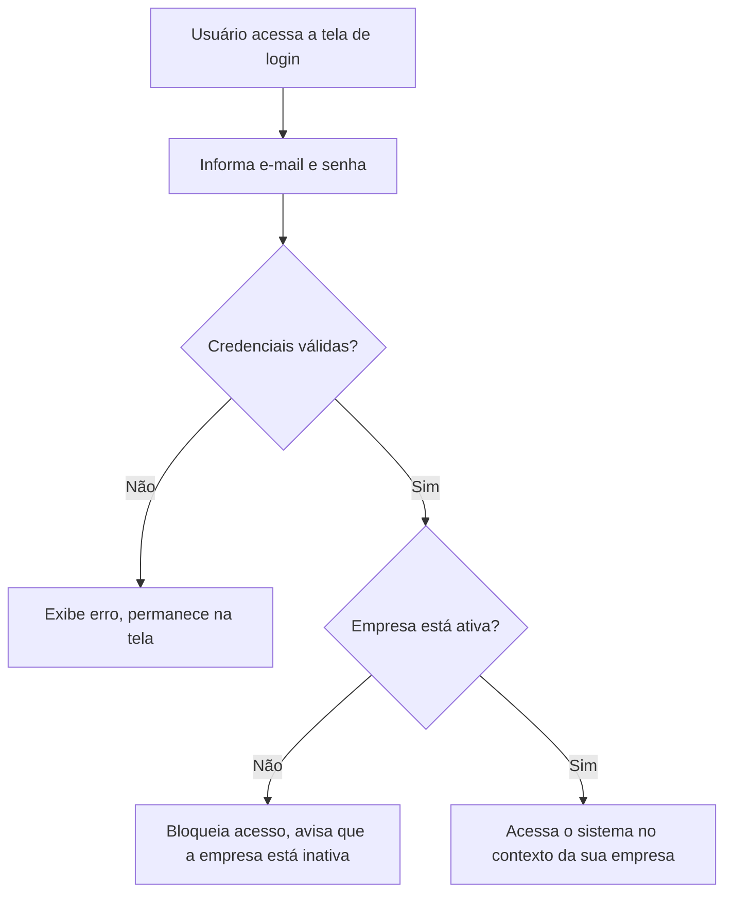
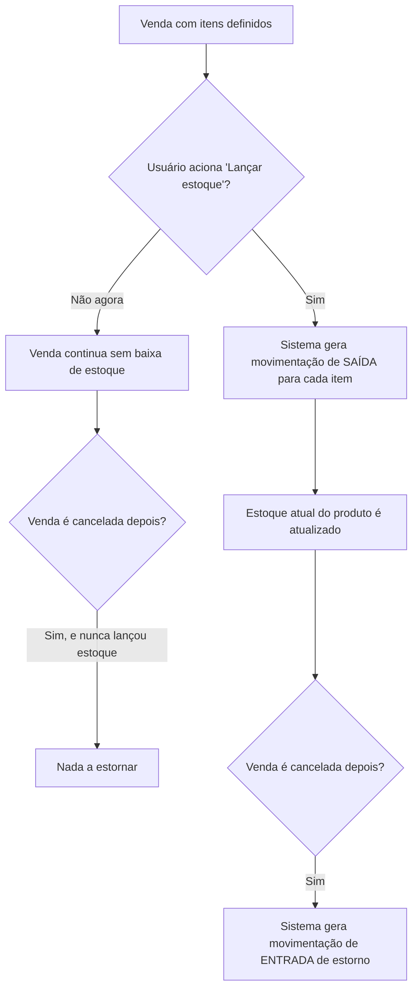
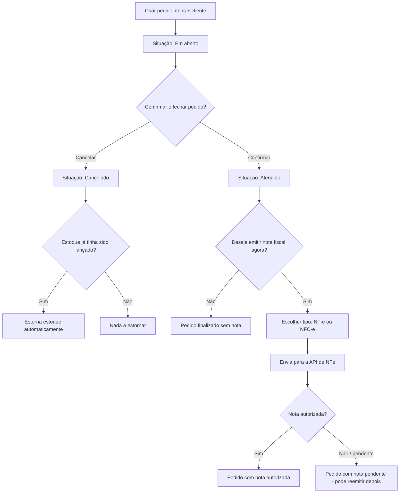
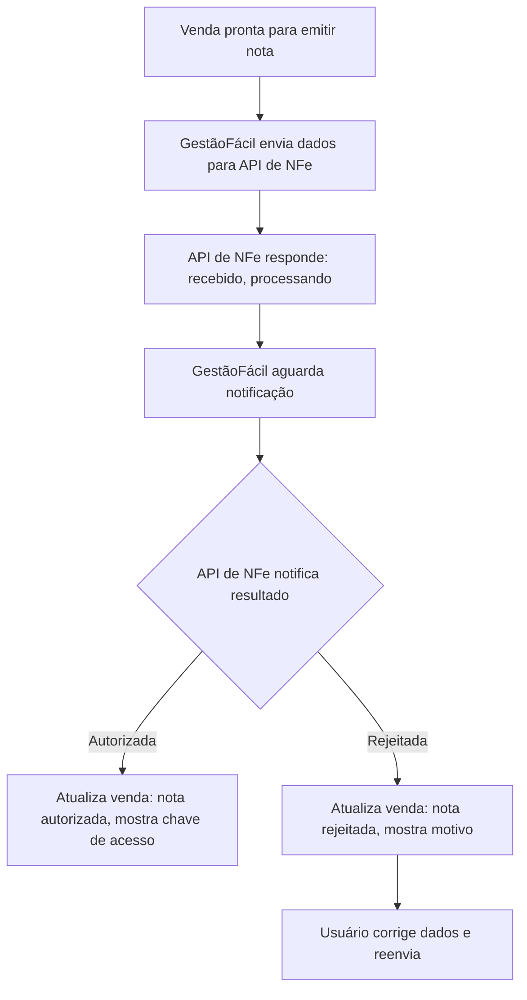

# Documento de Requisitos — GestãoFácil

Este documento descreve **o que** o sistema faz, do ponto de vista de negócio — módulos,
campos, regras e fluxos. Detalhes técnicos (banco de dados, endpoints, arquitetura) estão
em `PLAN-API.md` e `PLAN-UI.md`. Para notas de design, princípios de UX, velocidade do PDV
e identificação de gaps, ver `UX-DESIGN-NOTES.md`.

**Escopo desta primeira versão:** Login, Multiempresa, Produtos, Estoque, Clientes, Vendas
(PDV com NFC-e modelo 65 + Pedido com NF-e modelo 55), integração com API de emissão de nota fiscal. Financeiro fica para
uma fase futura, fora deste documento.

**IMPORTANTE:** v1 implementa **ambos**:
- **PDV** com NFC-e (modelo 65) — vendas rápidas no balcão, com emissão de comprovante fiscal B2C
- **Pedido** com NF-e (modelo 55) — vendas administrativas, com nota fiscal B2B

---

## 1. Visão Geral

O GestãoFácil é um sistema de gestão para pequenas empresas — controle de produtos,
estoque, clientes e vendas (pedido), com emissão de nota fiscal integrada. É
**multiempresa**: uma única instalação do sistema atende várias empresas, cada uma com
seus próprios dados, produtos, clientes e vendas, sem nenhuma visibilidade cruzada entre
empresas diferentes.

O sistema é composto por três camadas:
- **GestãoFácil API** (backend de negócio) — onde os dados de venda, clientes, produtos vivem e as regras de negócio são aplicadas
- **GestãoFácil UI** (frontend web) — onde o usuário efetivamente trabalha no dia a dia
- **NFe-API** (backend de fiscal, separado) — serviço dedicado para emissão de nota fiscal

### Arquitetura de Integração

```
GestãoFácil (este projeto)
├── Backend: Lógica de venda, produtos, clientes
│   └── Integração com NFe-API (cliente HTTP)
└── Frontend: Telas de pedido, emissão, status

NFe-API (projeto separado em nfe-api/)
├── Backend: Emissão de NF-e, comunicação com SEFAZ
│   ├── Recebe venda em JSON via POST /api/v1/nfe
│   ├── Retorna 202 + protocolo_id (assíncrono)
│   ├── Processa em fila (Horizon)
│   └── Notifica GestãoFácil via webhook ou polling
└── Admin: Painel Filament para gerenciar certificados
```

A emissão fiscal (NF-e) não é feita pelo GestãoFácil diretamente — ele delega essa
parte para a API de NFe separada (nfe-api), enviando os dados da venda em JSON e
recebendo de volta o status da nota (autorizada, rejeitada, etc.) via webhook ou polling.

### Fronteira de Dados entre as duas APIs

A separação não é só de código — é de **dados**. A API de Vendas guarda apenas o que é
estritamente necessário para o funcionamento comercial e operacional; ela **não precisa e
não deve** conhecer os detalhes fiscais da emissão.

| Categoria | Dados | Onde vive |
|---|---|---|
| **Compartilhados** | CNPJ/CPF, razão social, nome fantasia, endereço, e-mail comercial | Nas duas APIs |
| **Só no Serviço de NFe** | Certificado `.pfx` e sua senha, Inscrição Estadual (IE), Inscrição Municipal (IM), CNAE, código IBGE do município (`cMun`), regime tributário (CRT), CSC da NFC-e, série e sequência numérica das notas | `nfe-api` |
| **Só na API de Vendas** | Plano de assinatura do SaaS, usuários/funcionários que acessam o app, histórico de pedidos, catálogo comercial e base de clientes | `gestaofacil-api` |

Única exceção: a API de Vendas mantém um **espelho somente-leitura** de `cnpj_certificado`,
`certificado_validade`, `status_certificado` e `ambiente`, sincronizado a partir das
respostas do `nfe-api`, apenas para exibir status na tela e disparar avisos de vencimento.
A fonte da verdade continua sendo o Serviço de NFe.

Regras completas e checklist de merge em [SECURITY.md](SECURITY.md).

---

## 2. Módulo: Empresas (Multiempresa com Isolamento de Dados)

Cada empresa cadastrada no sistema é **completamente isolada** das demais — nenhum usuário de uma empresa
enxerga dados de outra. Esta é uma **prioridade de segurança crítica** implementada em arquitetura.

### Campos
| Campo | Descrição |
|---|---|
| Razão social | Nome oficial da empresa — exibido no painel e em relatórios |
| Nome fantasia | Nome pelo qual a empresa é conhecida (opcional) |
| CNPJ/CPF | Identificação da conta/tenant e cobrança do SaaS — único por empresa |
| Endereço | Endereço comercial (cadastro e exibição) |
| E-mail comercial | Contato e notificações do SaaS |
| Plano | Qual plano de uso a empresa está contratando (exclusivo da API de Vendas) |
| Status | Ativa ou inativa |

**Estes são os únicos dados de empresa que a API de Vendas guarda.** Dados fiscais
(IE, IM, CRT, código IBGE, certificado, série/numeração) **não** ficam aqui — ver
"Fronteira de Dados entre as duas APIs" na seção 1.

### Regras de negócio
- Um CNPJ pertence a uma única empresa — não duplicação.
- Uma empresa inativa bloqueia login de usuários e novas vendas, mas histórico permanece consultável.
- O certificado digital **não é armazenado na API de Vendas** — fica exclusivamente no
  Serviço de NFe, separado por empresa. A tela de Configuração Fiscal só faz o
  encaminhamento (ver seção 3).

### Isolamento de Dados (Implementação)

**CRÍTICO — Leia [SECURITY.md](SECURITY.md) antes de implementar qualquer feature:**

- Uma empresa NUNCA pode acessar dados de outra empresa, mesmo por bug ou exploit
- Middleware automático (`EnscopeToCompany`) filtra toda query por `empresa_id`
- Toda model com empresa_id tem Global Scope que aplica filtro automaticamente
- Cada novo endpoint valida que o recurso `{id}` pertence à empresa logada (defesa em profundidade)
- Toda fase adiciona testes de vazamento: criar 2 empresas, validar que nenhuma vê dados da outra
- Campos sensíveis (senhas, tokens) NUNCA aparecem em logs

**Se testes não cobrem vazamento entre empresas: NÃO PODE FAZER MERGE.**

### Telas
- **Lista de empresas** (visão administrativa, se o sistema tiver um usuário "dono" que gerencia todas)
- **Cadastro/edição de empresa** — dados básicos + link para configuração fiscal

---

## 3. Módulo: Configuração Fiscal (por empresa)

Esta tela existe no GestãoFácil UI, mas **nada do que se digita nela é armazenado na API
de Vendas**. A API de Vendas atua como *proxy sem persistência*: autentica o usuário,
resolve o CNPJ do tenant, repassa o conteúdo ao Serviço de NFe e guarda apenas o retorno
de status.

Por que o proxy e não um envio direto do navegador ao `nfe-api`: o token de client do
Serviço de NFe é segredo de servidor. Se ele fosse para o browser, qualquer usuário da
empresa poderia falar com o serviço fiscal por fora do aplicativo.

### Campos

| Campo | Onde é digitado | Onde fica armazenado |
|---|---|---|
| Certificado digital (.pfx) | Tela de Configuração Fiscal | **Só no Serviço de NFe** — arquivo em diretório privado do servidor |
| Senha do certificado | Tela (nunca exibida de volta após o cadastro) | **Só no Serviço de NFe** — criptografada no banco |
| Inscrição Estadual (IE) | Tela | **Só no Serviço de NFe** |
| Inscrição Municipal (IM) e CNAE | Tela | **Só no Serviço de NFe** |
| Regime tributário (CRT) | Tela | **Só no Serviço de NFe** |
| Código IBGE do município (`cMun`) | Derivado do endereço na tela | **Só no Serviço de NFe** |
| CSC e ID do CSC (NFC-e) | Tela | **Só no Serviço de NFe** — criptografado |
| Série da nota | Tela (só no onboarding) | **Só no Serviço de NFe** |
| Número inicial de NF-e | Tela (só no onboarding) | **Só no Serviço de NFe** |
| Número inicial de NFC-e | Tela (só no onboarding) | **Só no Serviço de NFe** |
| Ambiente (Homologação/Produção) | Tela | Serviço de NFe (fonte da verdade) + espelho na API de Vendas |
| Validade e status do certificado | Não é digitado — extraído do `.pfx` | Serviço de NFe + espelho na API de Vendas |

**Exibição dos dados já cadastrados:** como o emitente não fica guardado na API de Vendas,
a tela o lê do Serviço de NFe toda vez que é aberta. Se o serviço estiver indisponível ou
a empresa ainda não tiver certificado, os campos aparecem em branco em vez de a tela dar
erro. Série e numeração não são relidas: são campos de escrita, preenchidos só no
onboarding.

Os dois "números iniciais" são preenchidos apenas se a empresa já emitia notas em outro
sistema e precisa continuar a numeração sem duplicar perante a SEFAZ. A numeração de
NFC-e é independente da de NF-e.

### Regras de negócio

- Enquanto o certificado não estiver cadastrado e válido, a empresa não consegue emitir nenhuma nota — vendas continuam funcionando normalmente, só a nota fica pendente.
- Trocar de Homologação para Produção **não exige reenviar o certificado** — é uma ação separada, já que a senha do certificado não deveria precisar ser digitada de novo só pra isso.
- Renovar um certificado vencido não deve, por segurança, reiniciar silenciosamente o ambiente para Homologação — o ambiente atual é preservado a menos que alguém troque explicitamente.
- O sistema avisa a empresa quando o certificado está próximo do vencimento (30, 15 e 7 dias antes). O aviso usa o espelho de validade sincronizado do Serviço de NFe.
- O número inicial de NF-e/NFC-e só pode ser informado **uma vez**, no onboarding. Depois disso, mexer no contador é ajuste manual no Serviço de NFe — sobrescrever poderia voltar a numeração para trás e gerar número duplicado perante a SEFAZ (risco fiscal, não só técnico).
- A API de Vendas nunca pergunta a série nem o próximo número ao emitir: quem resolve a numeração é o Serviço de NFe, a partir do CNPJ, do modelo (55/65) e do ambiente.

### Regras de armazenamento (obrigatórias)

**No Serviço de NFe:**
- O arquivo `.pfx` fica em diretório privado do servidor, **fora da raiz pública** do Nginx/Apache (ex: `/var/app/storage/certificates/{company_id}/cert.pfx`), acessível apenas pelo usuário de sistema que roda o serviço.
- Permissões restritas no Linux: arquivo `chmod 400` (ou `600` se precisar reescrever na renovação), diretório `chmod 700`.
- O conteúdo em repouso é criptografado com uma chave mestra dedicada, separada da chave da aplicação.
- A senha do certificado fica **criptografada** no banco do Serviço de NFe — criptografada e não hasheada, porque precisa ser recuperável para abrir o `.pfx` na assinatura.
- A descriptografia acontece **exclusivamente em memória RAM** durante a assinatura do XML. Nunca é gravada cópia limpa do `.pfx` em `/tmp` nem em qualquer pasta temporária.

**Na API de Vendas:**
- Nunca grava o `.pfx` em disco, nem a senha no banco (nem criptografada).
- Nunca registra em log o payload do upload, a senha ou os dados do emitente.

Detalhamento técnico, comandos de provisionamento e testes obrigatórios em [SECURITY.md](SECURITY.md).

### Telas
- **Configuração fiscal da empresa** — upload de certificado, dados do emitente (IE, IM, CRT, endereço, CNAE), CSC da NFC-e, série e numeração inicial, seleção de ambiente, status de validade

---

## 4. Módulo: Login e Usuários

### Campos
| Campo | Descrição |
|---|---|
| Nome | Nome do usuário |
| E-mail | Usado para login e recuperação de senha |
| Alias (opcional) | Nome de usuário alternativo, único dentro da empresa (ex: "allan.empresa1") |
| Senha | — |
| Perfil | Ex: Administrador, Operador, Vendedor (define o que a pessoa pode fazer) |
| Empresa | A qual empresa esse usuário pertence |

### Regras de negócio
- Cada usuário pertence a uma única empresa nesta fase — não há usuário compartilhado entre empresas diferentes.
- Um Administrador pode cadastrar outros usuários dentro da própria empresa.
- Um Vendedor não tem acesso à Configuração Fiscal nem ao cadastro de outros usuários.
- O login pode ser feito com **email** ou com **alias** (se preenchido). Ambos devem ser únicos dentro da empresa.
- Um usuário que muda de empresa mantém seu email, mas pode ter um alias diferente em cada empresa.

### 🔐 Segurança de Senhas (CRÍTICO)

**Armazenamento:**
- Senhas armazenadas com bcrypt (NIST recomendado), NUNCA plaintext
- Cada senha tem salt único gerado automaticamente
- Impossível recuperar senha original do hash

**Força de Senha (Obrigatório):**
- Mínimo 8 caracteres
- Maiúscula + minúscula
- Pelo menos 1 número
- Pelo menos 1 símbolo (!@#$%^&*)
- Validação contra lista de senhas comprometidas (haveibeenpwned.com)

**Proteção Contra Força Bruta:**
- Máximo 5 tentativas de login por minuto
- 6ª tentativa: bloqueado por 60 segundos
- IP/email do atacante é rate-limitado, não todo o endpoint

**Recuperação de Senha:**
- Email com link de reset (válido por 24 horas, 1 uso apenas)
- Token aleatório de 64 caracteres (armazenado com hash SHA256 no banco)
- Ao fazer reset: invalida todas as sessões/tokens do usuário
- Senha NUNCA aparece em email, logs ou responses

**Ler:** [SECURITY.md](SECURITY.md) — seção "Proteção de Senhas"

### Fluxo — Login



### Telas
- **Login**
- **Esqueci minha senha** (recuperação por e-mail)
- **Gestão de usuários** (lista + cadastro, visível só para Administrador)

---

## 4.5. Módulo: Perfil do Usuário

O usuário logado pode acessar sua área pessoal para alterar dados da conta.

### Campos
| Campo | Descrição |
|---|---|
| Nome | Nome do usuário (editável) |
| E-mail | Exibido apenas (não editável nesta fase) |
| Alias | Alias da empresa (editável) |
| Senha atual | Obrigatório para alterar senha |
| Senha nova | Mínimo 8 caracteres |
| Confirmar senha | Deve coincidir com a nova senha |

### Regras de negócio
- Alterar senha exige informar a senha atual como validação.
- Senha nova deve ter mínimo 8 caracteres.
- Usuário não pode alterar seu perfil (Administrador, Operador, Vendedor) — apenas um Administrador pode fazer isso.
- Alterar e-mail fica fora desta fase.

### Telas
- **Perfil do usuário** (dados pessoais + alterar senha)

---

## 5. Módulo: Produtos e Estoque

### Campos — Produto
| Campo | Descrição |
|---|---|
| Nome | Nome do produto |
| SKU / Código | Código interno do produto |
| Código de barras | Opcional, usado no PDV |
| Preço de compra | Custo do produto (informativo, sem cálculos automáticos) — usado para referência futura e relatórios |
| Preço de venda | — |
| NCM | Código fiscal do produto, necessário pra emissão de nota |
| Unidade | Ex: UN, KG, CX |
| Estoque atual | Quantidade disponível (calculado a partir das movimentações) |
| Status | Ativo ou inativo (produto inativo não aparece pra venda) |

### Campos — Movimentação de Estoque
| Campo | Descrição |
|---|---|
| Produto | — |
| Tipo | Entrada, Saída ou Ajuste |
| Quantidade | — |
| Motivo | Ex: "Venda #123", "Estorno de cancelamento", "Ajuste de inventário" |
| Data/hora | — |

### Regras de negócio
- O estoque **não é baixado automaticamente** quando uma venda é criada ou muda de situação — é sempre uma ação explícita ("Lançar estoque"), que pode acontecer no momento de fechar a venda ou depois, conforme o usuário decidir.
- Toda alteração de estoque gera uma linha de movimentação — nunca se altera a quantidade do produto diretamente sem deixar rastro.
- Se uma venda que já teve estoque lançado for cancelada, o sistema gera automaticamente uma movimentação de **entrada** de estorno, referenciando a venda cancelada — o estoque não fica "preso".
- Um ajuste manual de estoque (ex: perda, quebra, contagem de inventário) é sempre feito com um motivo obrigatório.
- Um produto pode ser inativado (marcado como `ativo=false`), o que:
  - Remove o produto da busca padrão (mas filtro "Mostrar inativos" permite vê-lo)
  - Avisa ao usuário se tentar adicioná-lo em uma venda (mas ainda permite, para pré-vendas)
  - Preserva histórico — não deleta o produto, apenas marca como inativo

### Fluxo — Lançamento de estoque numa venda



### Telas
- **Lista de produtos** (busca, filtro por status)
- **Cadastro/edição de produto**
- **Movimentações de estoque** (histórico por produto)
- **Ajuste manual de estoque**

---

## 7. Módulo: Clientes

### Campos
| Campo | Descrição |
|---|---|
| Nome | — |
| CPF/CNPJ | Opcional — ver regra abaixo |
| Telefone | Opcional |
| E-mail | Opcional |
| Endereço | Opcional |

### Regras de negócio
- Uma venda **não exige** cliente cadastrado — pode ser registrada como "Consumidor Final", comum em venda de balcão (PDV).
- Se a venda for uma NF-e (não NFC-e), os dados do destinatário (nome, CPF/CNPJ, endereço) passam a ser obrigatórios, porque a nota fiscal exige isso legalmente.

### Telas
- **Lista de clientes** (busca)
- **Cadastro/edição de cliente**

---

## 8. Módulo: Vendas (PDV e Pedido, unificado)

Um único conceito de "Venda" atende tanto o balcão (PDV) quanto o pedido — o que muda é a
**origem** e o **estado inicial**, não a estrutura de dados.

### Campos
| Campo | Descrição |
|---|---|
| Origem | Pedido (PDV fica para v2 quando NFe-API suportar NFC-e) |
| Cliente | Obrigatório para venda registrada (Consumidor Final aceito) |
| Itens | Produto, quantidade, preço unitário, desconto |
| Situação | Em aberto, Atendido, Cancelado |
| Tipo de documento fiscal | NF-e ou Nenhum (NFC-e fica para v2) |
| Formas de pagamento | Uma venda pode ter mais de uma forma de pagamento |
| Total | Calculado a partir dos itens, descontos e despesas adicionais |
| **Campos de Rastreamento de NFe** | |
| `nf_protocolo_id` | UUID recebido da API nfe-api |
| `nf_chave_acesso` | Chave de acesso (44 dígitos) |
| `nf_chave_acesso_anterior` | Histórico: chave anterior se mudou por contingência |
| `nf_environment` | 1=produção, 2=homologação (herdado do certificado) |
| `nf_status` | queued, processing, authorized, rejected, cancelled |
| `nf_contingencia_ativa` | boolean: nota está em contingência SVC |
| `nf_xml_path` | URL para download do XML |
| `nf_danfe_path` | URL para download do PDF/DANFE |

### Regras de negócio
- **PDV** nasce com situação **Atendido** — é uma venda direta, já concluída no momento em que é registrada.
- **Pedido** nasce com situação **Em aberto** — o usuário pode cancelar ou confirmar (passar para Atendido) a qualquer momento.
- O **tipo de documento fiscal** tem um valor sugerido conforme a origem (PDV sugere NFC-e, Pedido sugere NF-e), mas pode ser alterado pelo usuário — a decisão de qual nota emitir depende de quem é o cliente, não só de onde a venda começou.
- Uma venda com múltiplas formas de pagamento precisa ter a soma dos valores pagos batendo exatamente com o total da venda.
- Cancelar uma venda não é uma exclusão — o registro permanece, só muda de situação, e dispara o estorno de estoque se aplicável (ver Módulo de Estoque).
- Uma venda **Atendida** não pode ter seus itens editados — para corrigir, é preciso cancelar e criar uma nova.
- A emissão de nota fiscal é **opcional** — tanto PDV quanto Pedido podem ser finalizados sem nota. A nota pode ser emitida depois através das opções da venda.

### Tipos de Comprovante (para Pedido)

Ao emitir nota de um pedido, o usuário escolhe entre 3 opções:

1. **Emitir NF-e (modelo 55)** — Nota fiscal com valor fiscal, obrigatória pra B2B. Gera chave de acesso, XML e DANFE (PDF).
2. **Apenas cupom não-fiscal** — Imprime recibo do pedido sem valor fiscal (backup/cópia), sem envio à SEFAZ.
3. **Nenhum comprovante** — Finaliza sem gerar nada. Pode emitir nota depois via "Opções da Venda".

**Padrão pré-selecionado**: "Emitir NF-e" (pode ser alterado conforme configuração futura).

### Fluxo — Venda no PDV

```mermaid
flowchart TD
    A[Abrir tela de PDV] --> B[Buscar e inserir produtos]
    B --> C[Selecionar cliente ou Consumidor Final]
    C --> D[Definir forma(s) de pagamento]
    D --> E{Soma dos pagamentos == total?}
    E -- Não --> D
    E -- Sim --> F[Venda registrada como Atendida]
    F --> G{Deseja emitir nota fiscal agora?}
    G -- Não --> H[Venda finalizada sem nota]
    G -- Sim --> I[Escolher tipo: NFC-e ou NF-e]
    I --> J[Envia para a API de NFe]
    J --> K{Nota autorizada?}
    K -- Sim --> L[Venda com nota autorizada]
    K -- Não / pendente --> M[Venda com nota pendente - pode reemitir depois]
```

### Fluxo — Pedido de Venda



### Telas
- **PDV** — tela de venda **extremamente rápida e intuitiva** (busca de produto em tempo real, carrinho inline, pagamento com botões atalho, opção de emissão de NFe/impressão de cupom). **Alvo: venda simples em < 1 minuto**. Ver `UX-DESIGN-NOTES.md` para princípios de velocidade.
- **Lista de pedidos** com filtros avançados:
  - Situação (Em aberto, Atendido, Cancelado)
  - Cliente (autocomplete com cuidado: paginar resultados pra não ficar lento com muitos clientes)
  - Período (data início e fim)
  - Usuário que criou (Administrador vê todos)
  - Ordenação: mais recente primeiro (padrão)
- **Cadastro/edição de pedido** — tela completa com detalhes do cliente, observações, descontos por item, lançamento de estoque controlado
- **Detalhe da venda** (itens, pagamentos, status da nota fiscal, histórico de estoque, opção de emitir nota depois, opção de imprimir documento)
- **Impressão** — cupom (PDV) ou documento de venda (Pedido)

---

## 9. Módulo: Emissão de Nota Fiscal (integração)

O GestãoFácil não emite nota fiscal por conta própria — ele envia os dados pra uma API de
NFe dedicada, que fala com a SEFAZ, e recebe de volta o resultado.

### Regras de negócio
- A emissão é **assíncrona**: ao pedir pra emitir, o sistema não trava esperando a SEFAZ responder — a venda fica com o status da nota como "processando" até a confirmação chegar.
- Se a nota for rejeitada, a venda continua existindo normalmente — o usuário pode corrigir os dados e tentar emitir de novo, sem precisar refazer a venda.
- O sistema mostra, na tela da venda, o status atual da nota: Não emitida, Processando, Autorizada, Rejeitada, Cancelada.
- Cancelamento de nota fiscal já autorizada segue prazo legal (definido pela SEFAZ) — depois desse prazo, não é mais possível cancelar a nota pelo sistema.

### Fluxo — Emissão e acompanhamento



### Operações Pós-Emissão

#### Carta de Correção (CCe)
Quando uma nota fiscal **já autorizada** contém informações erradas não-críticas (ex: CNPJ cliente errado, endereço errado), é possível emitir uma **Carta de Correção** sem cancelar a nota.

**Fluxo**:
- Usuário acessa detalhe da venda com NFe autorizada
- Clica "Emitir Carta de Correção"
- Seleciona o campo que precisa corrigir (cliente CNPJ, endereço, descrição do produto, etc)
- Informa o valor correto
- Sistema envia CCe para a API de NFe
- CCe é registrada no histórico da venda

**Regra legal**: CCe não pode corrigir valores (crítico) — somente informações descriptivas.

#### Inutilizar Numeração
Quando um número de série de nota fica **vago** (ex: vendedor começou uma nota e desistiu, a numeração pula), é necessário comunicar à SEFAZ que aquele número nunca será usado.

**Fluxo**:
- Usuário acessa: Configuração Fiscal > Inutilizar Numeração
- Seleciona tipo (NF-e ou NFC-e)
- Informa número ou range de números a inutilizar
- Insere motivo (ex: "Erro de digitação", "Teste")
- Sistema envia inutilização para API de NFe (CNPJ + série + modelo + range + motivo)
- SEFAZ confirma inutilização
- Registra no histórico com data/hora/usuário

**Regra legal**: Obrigatório regularizar números vagos com a SEFAZ.

**Fronteira de dados**: a série é informada pelo usuário **nesta operação** (ele precisa
dizer de qual série é a faixa vaga) — é parâmetro de um comando, não configuração guardada.
O registro que a API de Vendas mantém é **auditoria**: quem pediu, quando, qual série, qual
range e qual motivo. Ela continua sem ser dona da numeração: não incrementa, não reserva e
não decide o próximo número — isso é do Serviço de NFe (`nfe_numbering`).

### Telas
- **Status da nota fiscal** (dentro do detalhe da venda)
- **Reenvio de nota rejeitada**
- **Emitir Carta de Correção** (acesso via detalhe da venda)
- **Inutilizar Numeração** (acesso via Configuração Fiscal)

### Dependências da API nfe-api (Críticas para v1)

GestãoFácil pode lançar v1 SOMENTE quando a API nfe-api tiver:

1. **RealSefazGateway implementado** — não pseudocódigo, testado em homologação SEFAZ
   - Sem isso: notas ficarão em "processando" para sempre
   - Impacto: bloqueador total para emissão

2. **Numeração separada por ambiente** — homolog e produção com sequências independentes
   - Sem isso: números duplicados ao passar de homolog para produção
   - Impacto: SEFAZ rejeitará como duplicação

3. **Tratamento de contingência SVC documentado** — incluindo chave de acesso que muda
   - GestãoFácil já está preparado (armazena histórico), mas API precisa estar estável
   - Impacto: notas em contingência podem ficar com chaves inconsistentes

4. **Email para notificações de certificado** (ou documentar que será responsabilidade de GestãoFácil)
   - GestãoFácil implementa job próprio como fallback
   - Impacto: notificações de certificado expirando

5. **Suporte a NFC-e (modelo 65)** — essencial para PDV
   - Sem isso: PDV não consegue emitir comprovante fiscal
   - Impacto: PDV fica desabilitado ou emite cupom não-fiscal apenas

---

## 10. Experiência de Usuário — Responsividade e Mobile

### Princípios
- O sistema deve funcionar **no desktop em primeiro lugar** — é a prioridade de v1.
- **Responsividade mobile**: todas as telas devem ser utilizáveis em dispositivos móveis (tablets e smartphones).
- **PDV em mobile**: uma POC paralela deve avaliar a viabilidade de rodar o PDV diretamente em celular/tablet, com suporte a leitura de código de barras via câmera.

### Requisitos de responsividade
- Grid flexível que se adapta de desktop (3+ colunas) para mobile (1 coluna).
- Botões e inputs com tamanho adequado para toque (mínimo 44x44px).
- Sem scroll horizontal — conteúdo deve sempre caber na largura da tela.
- Menu navegável em mobile (collapse/drawer).

### POC — PDV em Mobile
- Testar a entrada de dados (busca de produto, código de barras, pagamento) em dispositivos reais.
- Definir se é web responsivo ou aplicação nativa/PWA.
- Avaliar usabilidade e performance antes de investir em build completo.

---

## 11. Módulo: Planos (estrutura preparada)

### Campos
| Campo | Descrição |
|---|---|
| Nome | Identificador do plano (ex: free, pro, business) |
| Descrição | Descrição amigável |
| Limite de usuários | Quantos usuários a empresa pode ter |
| Limite de NFe/mês | Quantas notas fiscais a empresa pode emitir por mês |
| Funcionalidades | Quais módulos/features estão ativos neste plano |

**Nota:** Não há limite de quantidade de produtos cadastrados — todos os planos permitem cadastrar produtos ilimitadamente.

### Regras de negócio
- Cada empresa está vinculada a um plano na tabela de empresas.
- **Nesta primeira versão**, os planos não possuem cobrança automatizada — servem apenas para controle de funcionalidades e alertas.
- Validações de limites devem exibir avisos ao usuário, mas não bloqueiam operações (apenas informam que o limite foi atingido).
- Preparar a estrutura agora permite ativar validações e cobrança em versões futuras sem grandes refatorações.

### Telas
- (Nenhuma tela para v1 — configuração apenas administrativa)

---

## 12. Fora de escopo nesta fase (fica para depois)

- Módulo Financeiro (contas a pagar/receber, fluxo de caixa)
- Controle de caixa (abertura/fechamento, sangria, suprimento)
- Configuração de múltiplas impressoras e cravação por caixa (impressoras térmica, A4, etiqueta) — será avaliado em v2
- Parcelamento com geração automática de parcelas financeiras
- NFS-e (nota de serviço)
- Relatórios avançados de vendas e rentabilidade (v2)
